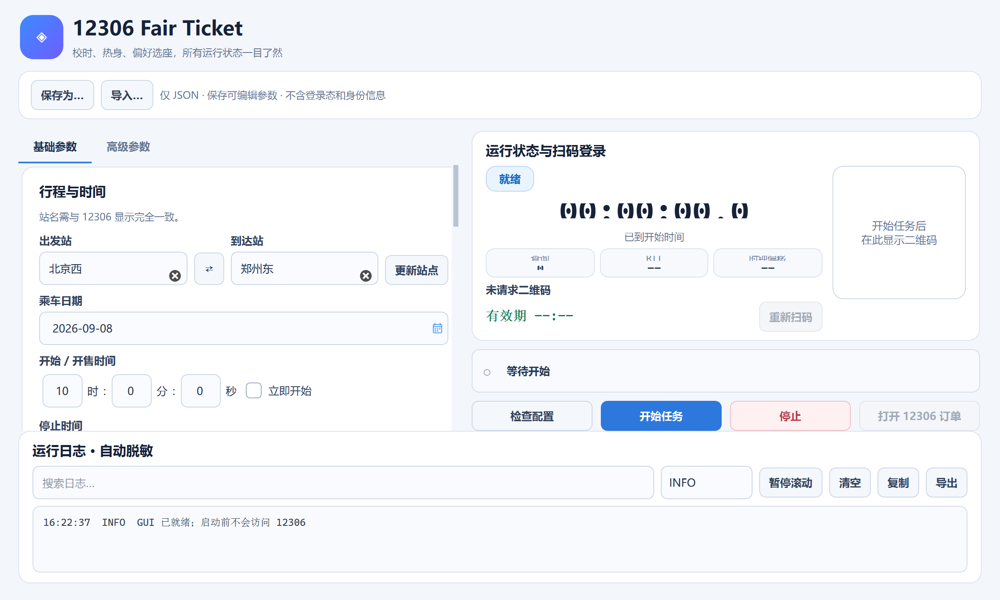

# Ticket · 12306 票务工作台

> 文档中的 example.com 域名、192.0.2.* 地址、/opt/operator 路径及 20000 段端口均为示例，请按实际部署配置替换。私有账号配置与运行数据不随源码提交。

[](LICENSE)

从 `bifrost/applications/ticket` 提取的独立票务项目。
Web 页面、票务引擎、Qt 桌面程序和原有测试均保留；独立 Web 服务无需 Bifrost、Qt 或前端构建。

## 启动

需要 **Python 3.10+**。克隆后运行：

```bash
git clone https://github.com/liuyishoua/ticket.git
cd ticket
python3 start.py
```

首次自动创建 `.venv` 并安装依赖；成功后尝试打开 **http://127.0.0.1:20002**。
Windows 可双击 `start.bat`，macOS 可双击 `start.command`，Linux 可运行 `./start.sh`。
首次安装需要联网；按 Ctrl+C 停止服务。

页面没有额外的控制台登录。真实查票、乘车人查询及购票需要在「账号管理」添加账号并使用12306 App扫码登录。
本项目没有 `--demo` 模式，添加账号或保存任务不会直接开始下单；任务必须明确启动。

在已有 Python 环境里，也可以直接运行：

```bash
python -m pip install -r requirements.txt
python -m web
```

修改端口或关闭自动打开浏览器：

```bash
python3 start.py --port 20026 --no-browser
```

## 功能

- 多账号独立会话、扫码登录与会话状态记录。
- 车票查询，按车次、车站、席别、余票、时段及价格筛选。
- 车次和席别优先级、座位与铺位偏好、查询频率和执行时间设置。
- 任务创建、手动启动、停止、预约核验及执行日志。
- 订单确认后展示订单号，引导到12306官方完成支付。

预约是本地程序的执行安排，不代表12306已受理或占票。启动任务后，发现符合条件的车票会自动提交订单。
提交结果不确定时保留需核对状态，不自动重复提交；支付、官方订单取消及候补购票不由本控制台完成。
完整业务规则见 [web/README.md](web/README.md)。

## 界面预览

以下图片来自独立 Web 服务的初始页面，未使用真实账号或订单。

车票查询工作台（本地资料）

12306账号管理（本地资料）

原 Qt 桌面界面也随仓库保留：



## 数据与运行

默认监听 `127.0.0.1:20002`。数据位于 `.runtime_web/`，首次启动自动建库：

- `workbench.sqlite3`：账号备注、任务配置、日志和会话诊断。
- `sessions/`：按账号保存的登录会话凭证。

这些文件已被 Git 忽略，不包含在仓库中。备份前停止服务，再复制整个数据目录。
预约期间需要保持服务运行，机器不能休眠。同一数据目录只启动一个服务。
更多启动参数与验证命令见 [docs/run.md](docs/run.md)。

## 桌面和命令行

原桌面程序见 [README_GUI.md](README_GUI.md)，启动方式：

```bash
python -m pip install -r requirements-gui.txt
python gui.py
```

原 `main.py` 是命令行购票入口，按 `config.py` 执行，可能发起真实登录及订单操作，不是 Web 服务启动命令。
旧桌面说明保存在 [README_DESKTOP.md](README_DESKTOP.md)，其中 Windows Release 文件尚未在本独立仓库发布。
`app.yaml` / `package.yaml` 保留用于 Bifrost 接入，独立运行不使用其中的平台路径。

## 使用许可

**本项目仅供学习、研究、测试及其他非商业用途，不得用于商业目的。**
对本仓库中版权所有者拥有权利的代码，沿用 Bifrost 的
[PolyForm Noncommercial License 1.0.0](LICENSE)，保留原版权声明；商业使用须事先取得版权所有者的单独授权。
本项目属于**源码可见、限制商用**，不应标为 MIT 或 OSI 意义上的开源许可证。
第三方代码、素材及依赖仍受各自许可证约束，详见 [THIRD_PARTY_NOTICES.md](THIRD_PARTY_NOTICES.md)。
